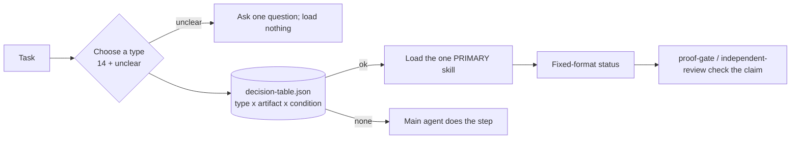

# tisserand

**Typed, checkable skills for coding agents.** Type the task, look up one skill, check the result.

  

Each task gets one of 14 types (or `unclear`). A generated table maps the type to at most one skill. The skill is a short checklist with fixed status words, so its output can be checked by a person, a script or another agent.

> **Experimental, not activated (v0.x).** 18 skills, a typed taxonomy, a generated decision table, a verifier benchmark and provenance checks. We have **not** measured whether these skills change agent behaviour. See [Status and limits](#status-and-limits).

## Quick start (about a minute)

Needs Python 3.11+ and git. Clone the repository, enter it, then:

<!-- quickstart -->
```bash
python3 -m venv .venv
. .venv/bin/activate
python -m pip install -r requirements.txt
python -m skillkit check
python -m skillkit gen --check
python -m unittest discover -s tests -t .
```

`check` runs every registry check. Without the private provenance records it reports `provenance: INCOMPLETE (n: source text unavailable)`, never OK. That is expected for a clone; see [Provenance](#selvedge-provenance-as-data).

After the quick start, four tests skip in a fresh clone because they need the private provenance reference tree (two more skip if PyYAML is missing). The skip message names the reason; set `SKILLKIT_SOURCES_ROOT` to a reference tree to run them. A skip is not a pass.

The skills are not self-contained yet. Most of them cite files elsewhere in this repository (`policy/`, `adapters/`, `taxonomy/`, `decision-table.json`), so use them from this clone, with the agent working at the clone root, where those paths exist. Copying one skill folder elsewhere leaves those citations unresolved; see [Install](#install). Start with `fault-loop`, `thin-slice` and `proof-gate`.

## Five-minute tour

1. **Ask the experimental router for a capability plan.** `route` scores the task text against each skill's registered intents and prints a plan: one `primary` skill or `abstain`, plus any supporting or reference skills. It does not choose a task type and does not read the decision table; it is a word-matching experiment, not the typed lookup described below.
   ```bash
   python -m skillkit route --format text "find the root cause of the failing test"
   ```
   Look at the `primary:` line. An empty `reasons:` line means nothing unusual happened.

   Captured output:
   ```text
   primary: fault-loop
   supporting: -
   reference: -
   mode: -
   reasons: -
   ```
   **It often abstains, by design.** Rephrase the task and the plan can change:
   ```bash
   python -m skillkit route --format text "the login test started failing after the last merge"
   ```
   Captured output:
   ```text
   primary: abstain
   supporting: -
   reference: -
   mode: -
   reasons: below_tau
   ```
   `below_tau` means the best match scored under the threshold; `low_margin` means two skills scored too close to call. On abstain, load nothing and pick the task type yourself (see [the heddle](#the-heddle-how-routing-works)). Naming a skill in the task (for example "use fault-loop to …") makes it the primary, with reason `named_primary:fault-loop`. Add `--trace` (JSON output only) to see each candidate's feature scores. How often the router is right is in [Status and limits](#status-and-limits).
2. **Read the skill it chose.** Open `skills/fault-loop/SKILL.md`. Note the numbered steps (observe the symptom before changing anything), the report fields and the correction budget it cites (`policy/correction-ladder.md`).
3. **Check the routing data.** The taxonomy, ratings and table are data, validated offline:
   ```bash
   python -m skillkit task-data validate
   python -m skillkit task-data collisions
   ```
   Captured output (excerpt):
   ```text
     "collisions": [],
   ```
4. **Watch a verifier get caught.** VerifierBench feeds invented verifier outputs (perfect, false PASS, stale evidence) through the scorer and runs every fixture check:
   ```bash
   python -m unittest tests.test_verifierbench -v
   ```
   Captured output (last lines; the time varies):
   ```text
   Ran 9 tests in 0.729s

   OK
   ```
5. **See the provenance state.**
   ```bash
   python -m skillkit check --format json
   ```
   Look for `provenance_complete: false` in a clone.

   Captured output (excerpt):
   ```text
     "provenance_complete": false,
   ```

## The heddle: how routing works



Choosing the type is the only judgement call. Everything after it is a table lookup. Ties are settled by named conditions: your own change → `verify`, otherwise finished work → `review`; outside facts → `research`, otherwise `explore`; `clarify` over `design`; any type over `answer`. The always-on `skill-router` skill does this in seven steps.

| Type | Rows | PRIMARY skill | Otherwise |
|---|---|---|---|
| clarify | 6 | `intent-contract` | — |
| design | 6 | `interface-design` (1), `context-design` (1) | 4 rows: main agent |
| plan | 12 | `bounded-plan` | — |
| implement | 6 | `thin-slice` | — |
| debug | 6 | `fault-loop` | — |
| verify | 6 | `proof-gate` | — |
| review | 6 | `independent-review` | — |
| deliver | 6 | — | main agent |
| document | 12 | `session-reconcile` (2) | 10 rows: main agent |
| research | 6 | `research-first` | — |
| explore | 24 | — | main agent |
| setup | 6 | `integrating-agent-capabilities` (1) | 5 rows: main agent |
| handoff | 12 | `handoff` when named | named use only |
| answer | 6 | — | main agent, by design |
| unclear | 6 | — | ask one question |

126 rows: 53 have a skill, 55 are left to the main agent, 12 are named-only and 6 ask a question. Empty cells are deliberate: a skill is added only after real use shows the gap.

## Skills

| Skill | Type | Activation | Does |
|---|---|---|---|
| `intent-contract` | clarify | contextual | turns an unsettled request into checkable done-criteria |
| `decision-interview` | clarify | explicit | one question per turn with a recommended answer |
| `interface-design` | design | contextual | UI states, input paths and a check plan before building |
| `context-design` | design | contextual | what an agent loads, when, and at what cost |
| `bounded-plan` | plan | contextual | a sized plan of checked steps, or a ticket map for multi-session work |
| `file-based-planning` | plan (supporting) | contextual | progress, findings and dead ends kept on disk |
| `thin-slice` | implement | contextual | builds a known change in thin, checked slices |
| `fault-loop` | debug | contextual | proves the cause before changing anything |
| `proof-gate` | verify | contextual | one evidence record per criterion from checks run now |
| `independent-review` | review | contextual | tests each claim against evidence; rule-based verdict |
| `final-audit` | review (supporting) | contextual | pre-acceptance audit of work claimed finished |
| `research-first` | research | contextual | current, version-specific facts from primary sources |
| `code-intelligence` | explore (supporting) | contextual | symbols and references through a semantic-tool adapter |
| `session-reconcile` | document | contextual | lists drift between changes and docs; fixes only approved items |
| `integrating-agent-capabilities` | setup | contextual | discovers, reuses and binds agent tools without duplicates |
| `handoff` | handoff | explicit | continuation note from checked state |
| `terse-output` | style | explicit | shorter prose; code, numbers and errors stay exact |
| `skill-router` | routing | always | pick a type, look up the row, load one skill |

**Pointers** (named use only; their text is not copied): BMAD-METHOD, OpenSpec, Understand-Anything, caveman.

Every skill shares one retry rule, the [correction ladder](policy/correction-ladder.md): a first attempt, then at most three recorded corrections; the count never resets and is handed on with the work.

## VerifierBench

Twelve newly invented mini-repositories with known outcomes: four true passes, four true failures and four evidence traps (for example, a check that exits zero but prints the wrong state). The review track adds two seeded defects. A standard-library scorer reports false PASS, false FAIL, claim-state accuracy and evidence freshness.

- Run its tests: `python -m unittest tests.test_verifierbench`.
- The protocol for real agent runs is in `bench/verifierbench/README.md`.
- **Real-host runs: not done.** The scorer and fixtures exist; no measurement of any agent has been published.

## Scale: from a one-line fix to a multi-session project

| Tier | Typical work | Skills | Gaps (the main agent works unaided) |
|---|---|---|---|
| 0. Daily | quick fact, small edit | `research-first`, `thin-slice` + `proof-gate`, `terse-output` (opt-in) | `answer` has no skill by design |
| 1. Task | bug, small feature | `fault-loop`, `thin-slice`, `proof-gate`, `code-intelligence` (supporting) | code exploration has no PRIMARY (24 rows) |
| 2. Feature | unclear request, UI, agent context, merge check | `intent-contract`, `interface-design`, `context-design`, `independent-review`, `final-audit` | most architecture decisions (4 of 6 design rows) |
| 3. Project | multi-step, multi-session | `bounded-plan`, `file-based-planning`, `handoff`, `session-reconcile`, `decision-interview` | durable docs (10 of 12 document rows) |
| 4. Programme | release, setup | `integrating-agent-capabilities` (agent tooling only); pointers to OpenSpec and BMAD | release closeout (6 deliver rows), system setup (5 of 6) |

## Local models: a scaffold, not parity

The design aims to put every computable decision in data and code so a small model only makes small, constrained choices. Whether a small local model then performs as well as a frontier model is **unmeasured**; we have not compared them and we do not promise it.

| Fixed in data or code, not left to the model | The model must |
|---|---|
| table lookup: type × artifact × condition → one skill (the table exists today; a `lookup` command is [target]) | pick one of 15 type tokens (or answer yes/no condition questions) |
| tie-breaks (named conditions in `taxonomy/tt-1.toml`) | follow one short skill, step by step |
| registry checks and provenance gate | fill fixed tables: claim states, evidence references, correction count |

- Today: the taxonomy and table are plain data files, validated by `skillkit task-data validate`.
- **[target]** `lookup TYPE` and `route --menu` (no model needed), ~1 KB compact skill forms, and a local runner that loads one skill, constrains each answer to a grammar, runs the checks itself and carries the correction count.
- We found no small local model that met our bar for an automatic type chooser in our tests, so none ships. Other models, settings or bars may give a different result.

## Status and limits

- **Behavioural benefit: unmeasured.** No comparison of the same tasks with and without these skills exists yet. Passing checks and benchmark tests show the tooling works, not that agents do better with the skills.
- **Local vs frontier models: unmeasured.** No comparison exists; parity is not claimed.
- **VerifierBench:** fixtures and scorer exist; runs on real agent hosts have not been done.
- **Text router: target not met.** In our recorded development baseline (2026-11-05), the lexical `route` picked the expected primary skill (top-1) for 0.316 of reachable positive and neighbour tasks (n=231) and 0.233 of all development positive and neighbour tasks (n=313); composition tasks are scored by separate metrics. "Reachable" leaves out tasks whose expected skill is explicit-only and not named in the task, which the router is not allowed to pick. The target was 0.85. These figures are for our development set only and do not describe performance on other tasks. Experimental.
- **Small local models:** we found no small local model that met our bar for an automatic type chooser in our tests; none ships.
- **Coverage:** 55 of 126 table rows have no skill.
- **Platform:** developed and tested on Linux; other hosts unmeasured.
- **Provenance:** the strict provenance check (`--provenance strict`) reports COMPLETE in our private checkout with the private source records; every skill is INDEPENDENT or ORIGINAL (`CREDITS.md`). This is an automated record-and-overlap check, not a licence clearance or legal review. A release still waits on the export step, a name/trademark check and owner approval.

## Selvedge: provenance as data

Every skill records where its ideas came from, under which licence, and whether its text was compared with that source. `CREDITS.md` is generated from those records and never edited by hand.

- `python -m skillkit check` uses `--provenance public` by default: every other check must pass, and provenance reports COMPLETE, INCOMPLETE or FAILED, never a silent OK.
- `--provenance strict --sources-root <dir> --evidence-map <file>` needs the private source records. A release requires strict and ships a sanitized summary bound to the source tree hash and per-file sha256.
- Dispositions: INDEPENDENT (compared with the named source; no shared 8-gram found) and ORIGINAL (our own text, written from idea notes or a behaviour contract). The gate also recognises LEGACY-UNATTESTED (earlier text, origin not attested) and UNKNOWN (not analysed) and treats both as not cleared; no skill currently carries either. An overlap result is not licence clearance.

Ideas (mechanisms only) came from these projects; per-skill revisions, licences and dispositions are in [`CREDITS.md`](CREDITS.md):
obra/superpowers · mattpocock/skills · OthmanAdi/planning-with-files · muratcankoylan/Agent-Skills-for-Context-Engineering · KKKKhazix/khazix-skills · garrytan/gstack · backnotprop/pstack · addyosmani/agent-skills · github/spec-kit · trailofbits/skills (CC-BY-SA-4.0; compared, idea credit only) · JuliusBrussee/caveman (Apache-2.0) · bmad-code-org/BMAD-METHOD · Fission-AI/OpenSpec · Egonex-AI/Understand-Anything · LambdaTest/agent-skills · multica-ai/andrej-karpathy-skills (licence file not found) · published research on verifiers.

## Safety model

Skills are **instructions, not sandboxes**.

- `activation`, `risk` and `access` fields are advice to the agent and to harnesses that honour them. Nothing enforces them.
- A skill can lead an agent to run commands, edit files or use the network, within your harness permissions.
- Review skills before installing them and keep permissions tight. Report problems as described in [`SECURITY.md`](SECURITY.md).

## Install

Skills are not self-contained. 16 of the 18 `SKILL.md` files cite repository files by relative path, such as `policy/correction-ladder.md` and `adapters/`; `skill-router` also needs `decision-table.json` and `taxonomy/tt-1.toml`. Those files sit outside `skills/<id>/`, and no route below bundles or links them for an installed skill. Only `intent-contract` and `terse-output` cite none.

| Route | What it does today | Status |
|---|---|---|
| use the skills from a clone, with the agent working at the clone root | every cited repository path exists relative to that root | supported today; whether agents do better with the skills is unmeasured |
| copy or symlink one `skills/<id>/` into your agent's skills folder | puts that one directory there; the repository files it cites are not beside it | not self-contained; resolution of citations through a symlink is not verified |
| `./scripts/install.sh --system --all`, then `./scripts/doctor.sh` | copies each skill directory to `$AI_TOOLS_ROOT/skills/installed/` (default `~/AI-tools`); links those copies into a shared agent-skills folder in the user's home and, when present, each supported agent host's user skill folder there, replacing same-name symlinks; links `INDEX.md`, `catalog.yaml`, `capabilities.md`, `categories/` and the entries of `guidance/`, `workflows/` and `plugins/`. May create `.venv` and download PyYAML | partial: `decision-table.json`, `taxonomy/`, `policy/` and `adapters/` are not provided, so `skill-router` and the other skills that cite them are incomplete in that runtime |
| installed skills that carry or locate the repository files they cite | | [target] |
| `install --harness <name>` | | [target] |
| package or plugin manifest | | [target] |

## Repository layout

| Path | What it holds |
|---|---|
| `skills/<id>/` | the 18 skills: `SKILL.md` (instructions) and `capability.toml` (type, activation, risk, access, provenance) |
| `taxonomy/`, `decision-table.json` | the closed task-type taxonomy and the generated table that maps each task type to skills |
| `ratings/` | per-skill ratings against the rubric, with cited evidence |
| `registry/` | generated registry (`index.json`, `catalog.json`, `graph.json`, lock file) and `migrations.toml` for renamed or retired ids |
| `policy/` | shared rules the skills cite (correction ladder), router parameters, and the neutrality and privacy lint configuration |
| `schema/` | JSON schemas for capability files, frontmatter and generated registry files |
| `skillkit/` | the toolkit: `check`, `gen`, `lint`, `route`, `provenance`, `bench` |
| `scripts/`, `bin/tisserand` | install, doctor, uninstall and validation scripts, and the command-line wrapper |
| `adapters/` | notes for optional external tools (semantic code index, web research, capability registry) |
| `bench/verifierbench/` | the verifier benchmark tracks and scorer |
| `workflows/`, `plugins/` | pointers to external workflows and plugins, with their install notes |
| `sources/` | provenance notes: which outside ideas informed which skill (ideas only, no copied text) |
| `INDEX.md`, `catalog.yaml`, `capabilities.md`, `categories/`, `guidance/` | compact discovery files generated for agent runtimes; `build_registry.py` regenerates them and CI checks they are current |
| `release/provenance-summary.json` | sanitized provenance summary, present in release snapshots |
| `tests/` | unit and fixture tests (`python -m unittest discover -s tests -t .`) |

## Contributing

Read [`CONTRIBUTING.md`](CONTRIBUTING.md). In short: write in your own words, record provenance, run `gen` and `check`, and make no effectiveness claim without published, reproducible evidence.

## Licence

MIT for our own content ([`LICENSE`](LICENSE)). Third-party material, if any, keeps its licence; see [`THIRD_PARTY_NOTICES`](THIRD_PARTY_NOTICES). Citation metadata: [`CITATION.cff`](CITATION.cff).
